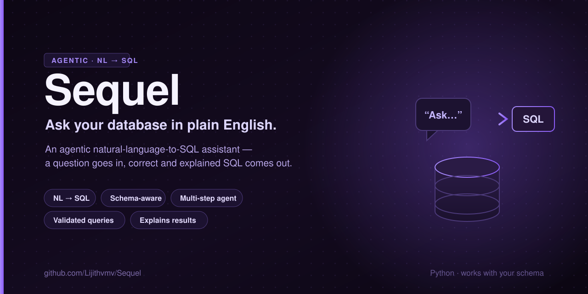
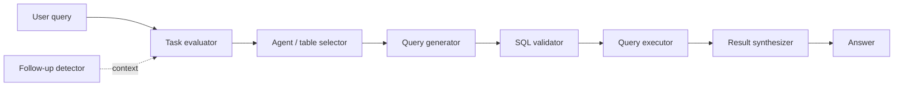

<p align="center">
  
</p>

# Sequel

> **Ask your database in plain English.** Sequel is an agentic natural-language-to-SQL assistant:
> ask a business question and get a generated SQL query, its results, and a synthesized answer —
> driven by a multi-step agent pipeline.


## Why this exists

Business users shouldn't need SQL to answer data questions. This service turns a natural-language
query into a SQL statement against a known schema, runs it (read-only), and explains the result —
with follow-up awareness so a conversation ("...and just for last month?") keeps context.

## How it works

The agent runs as a staged pipeline (in `core/actions/`):



- **`main.py`** — FastAPI server. Main endpoint: `POST /business-solutions/sql-agent/run`
  (`{session_id, user_query, chat_id}`); health at `/health_check`.
- **`app.py`** — `process_data_insight(...)`, the core orchestration called by the API.
- **`core/actions/`** — the pipeline steps: task evaluator, table selector, query generator, SQL
  validator, query executor, result synthesizer, chat history, follow-up handling.
- **`core/connectors/LLMClient.py`** — LLM access. **`core/utils/`** — DB access, data processing,
  filtering, follow-up detection, pandas helpers.
- **`prompts/`** — prompt templates for each agent step.
- **`streamlit_app.py`** — a simple chat UI that calls the backend.

## Quickstart

**Prerequisites:** Python 3.11, a reachable SQL database, and LLM credentials (see Configuration).

```bash
# create & activate a virtualenv
python -m venv venv
venv\Scripts\activate            # Windows
# source venv/bin/activate       # macOS/Linux

pip install -r requirements.txt

# configure (see below), then run the API
uvicorn main:app --reload --port 8086

# in another terminal, run the UI
streamlit run streamlit_app.py
```

## Configuration

Settings are read from a git-ignored `.env` (copy `.env.example`); `core/config.py` loads them with `python-dotenv`.
`DATABASE_URL` has **no default**: Sequel refuses to start a query without it.

## Safety: what stops a harmful query

- **The SQL validator step is an LLM judgement. It is not a safety control.** It can be wrong, and a crafted question
  could talk it into passing a bad query.
- **The deterministic guard is the control** (`core/utils/readonly_guard.py`). It runs in code right before execution
  and refuses anything that isn't one read-only statement:
  - more than one statement;
  - anything that doesn't start with `SELECT`, `WITH`, `SHOW`, `DESCRIBE` or `EXPLAIN`;
  - any write, DDL, privilege, session or file keyword, including `WITH ... DELETE` and `SELECT ... INTO OUTFILE`;
  - MySQL executable comments.

  It is strict on purpose: a refused read-only query is an inconvenience, a passed write is not. Tests:
  `tests/test_readonly_guard.py`.
- **Connect with a database user that only has `SELECT` rights.** The guard is a second line of defence, not a
  replacement for database permissions.
- Not covered: a read-only query can still read data the question shouldn't see. Restrict the user to the tables
  Sequel may query.

## Project structure

```
Project_NL2SQL5/
├── main.py                  # FastAPI entrypoint
├── app.py                   # core orchestration (process_data_insight)
├── streamlit_app.py         # chat UI
├── core/
│   ├── actions/             # agent pipeline steps
│   ├── connectors/          # LLM client
│   ├── utils/               # DB, data processing, follow-up, pandas helpers
│   ├── config.py
│   └── logger.py
├── prompts/                 # prompt templates
├── data_dictionary/         # schema descriptions
├── requirements.txt
├── table_descriptions.csv
└── *test*.py / debug_*.py   # dev/test scripts
```

## Roadmap

- [x] Move DB creds + LLM keys to `.env` (+ `.env.example`); remove any hardcoded config.
- [x] Deterministic read-only guard before execution.
- [ ] Reconcile the UI backend URL with the API route (UI points at `/data-insight`; API serves `/business-solutions/sql-agent/run`).
- [ ] Consolidate root-level `debug_*` / `test_*` scripts into `tests/` and `scripts/`.
- [x] Add a linter (ruff) + CI.

## Status

Working prototype. It runs the full NL→SQL pipeline. The query generator and validator haven't been evaluated for
accuracy on a public benchmark, and the root-level `debug_*` / `test_*` scripts are dev helpers, not a test suite.
